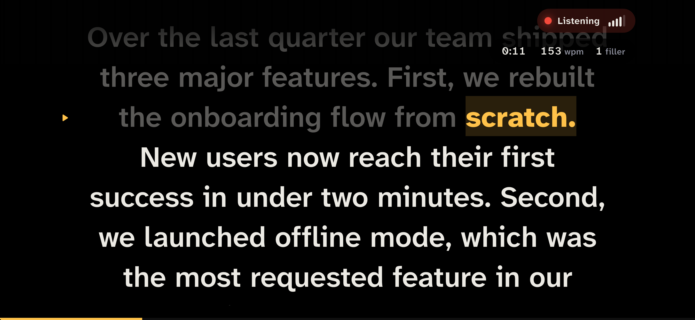
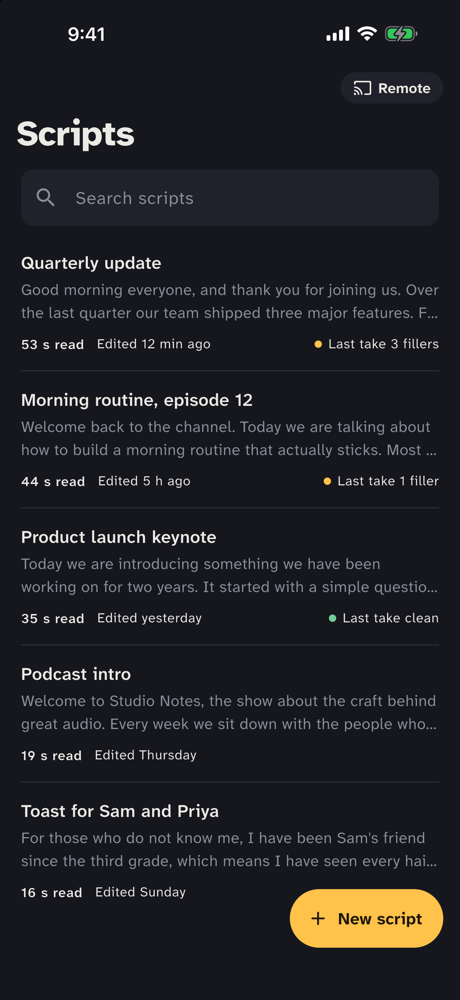
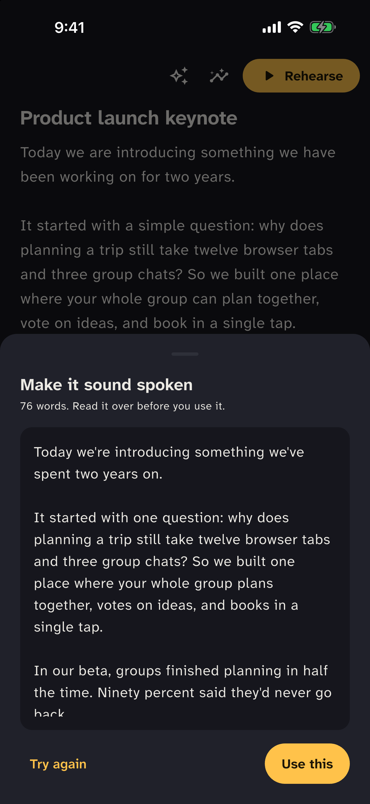
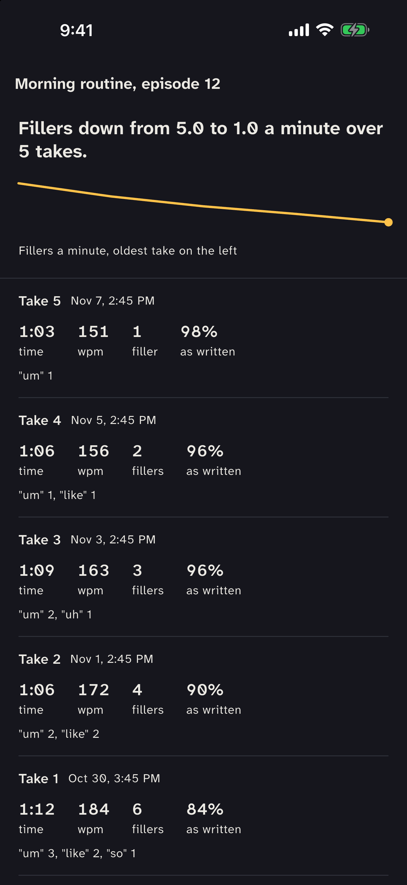
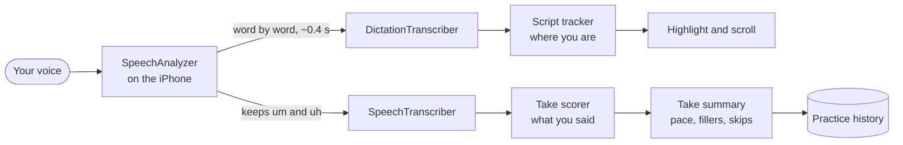
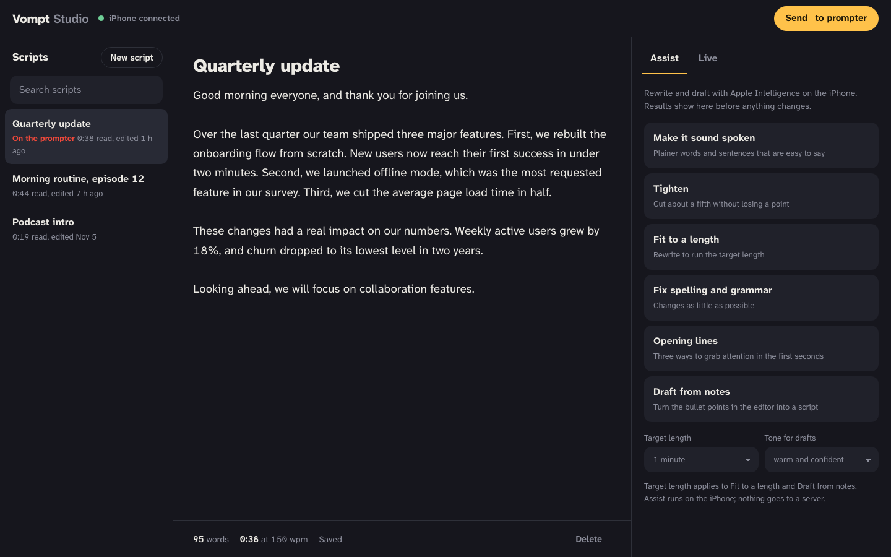

<div align="center">


# Vompt

**A teleprompter that follows your voice, and tells you how the take went.**

Free on iPhone and iPad. Everything runs on the device: no account, no cloud, no tracking.

</div>

<p align="center">
  
</p>

<table align="center">
  <tr>
    <td></td>
    <td></td>
    <td></td>
  </tr>
  <tr>
    <td align="center">Your scripts</td>
    <td align="center">Assist</td>
    <td align="center">Practice history</td>
  </tr>
</table>

## What it does

- **Scrolls with your voice.** Read at your own pace. The word you're on lights up and the script keeps the current line on the reading mark. Skip a line, go back, or ad-lib, and it catches up after a few words.
- **Counts your fillers.** "Um", "uh", "like", "you know": after every take you see how many, which ones, and how your pace compares to a comfortable 130 to 165 words a minute.
- **Shows what you missed.** Skipped sentences, words that didn't match the script, restarts, and long pauses.
- **Tracks your progress.** Every take is saved per script, with a trend line for fillers a minute.
- **Rewrites with Apple Intelligence.** Make a script sound spoken, tighten it, fit it to 60 seconds, fix grammar, get opening lines, or draft from bullet points, all on the device.
- **Runs from your computer.** Vompt Studio is a web page served by the phone on your Wi-Fi: write scripts with a real keyboard, use the same tools, and start, pause and watch the prompter live.
- **Built for real setups.** Mirror mode for beam-splitter glass, adjustable text size, works with AirPods and wired mics, keeps the screen awake.

## How it works



Vompt listens with two of Apple's on-device speech models at once (iOS 26 and later):

| Model | Job | Why |
| --- | --- | --- |
| `DictationTranscriber` | Follow the reader | About 0.4 s behind your voice, word by word |
| `SpeechTranscriber` | Score the take | Keeps "um" and "uh", which dictation removes |

The live transcript feeds an online alignment (Viterbi over every position in the script) that weighs skipping ahead, going back, misreads and ad-libs. Every position stays a candidate, so a wrong guess corrects itself instead of stranding the highlight. Finished sentences are aligned against the script to count fillers, skipped lines, misreads and restarts.

Older iOS versions fall back to Apple's standard speech recognition. Tracking still works there; "um" and "uh" can't be counted.

The engine is covered by tests that replay real recognizer output, including ad-libs, skipped sentences and re-reads (`vompt/test/engine`).

## Vompt Studio

Turn on Remote in the app and open the link on a computer on the same Wi-Fi. Studio is served by the phone itself; nothing goes through the internet, and the link carries a private key that changes each time.

<p align="center">
  
</p>

## Build from source

Requirements: macOS with Xcode 26 or later, Flutter 3.35 or later, and an iPhone or iPad on iOS 26 or later for the full speech engine.

```bash
git clone https://github.com/wrediam/Vompt.git
cd Vompt/vompt
flutter pub get
flutter test
flutter run --profile        # on a connected iPhone
```

To install on your own device, copy `vompt/ios/Flutter/Signing.xcconfig.example` to `Signing.xcconfig` in the same folder and put your Apple Developer Team ID in it. That file is git-ignored, so your team ID never ends up in a commit.

App Store screenshots are generated, not hand-made: `tools/screenshots.py` launches the simulator into staged screens with demo content. The app icon is drawn by `tools/make_icon.py`.

## Project layout

```
vompt/lib/
  features/teleprompter/engine/   speech tracking and take scoring (pure Dart, tested)
  features/teleprompter/          prompter screen, controls, take summary
  features/editor/                editor and the Assist sheet
  features/history/               practice history per script
  features/remote/                web remote: server status and navigation
  services/                       web server, Apple Intelligence tools, remote bridge
vompt/ios/Runner/                 native speech engine and Apple Intelligence bridge
vompt/assets/web/index.html       Vompt Studio, the browser remote
store/                            App Store listing and screenshots
tools/                            screenshot and icon generators
```

More detail in [docs/ARCHITECTURE.md](docs/ARCHITECTURE.md).

## Privacy

Audio and transcripts never leave the device, and nothing is recorded. Scripts and practice history are stored only on the device. The web remote works only on your local network and requires the private link shown on the phone. See [PRIVACY.md](PRIVACY.md).

## License

Vompt is source-available under the [PolyForm Noncommercial License 1.0.0](LICENSE.md). You can use, study, change and share it for any noncommercial purpose. You may not sell it or use it commercially. For other licensing, open an issue.

Contributions are welcome; see [docs/CONTRIBUTING.md](docs/CONTRIBUTING.md).
